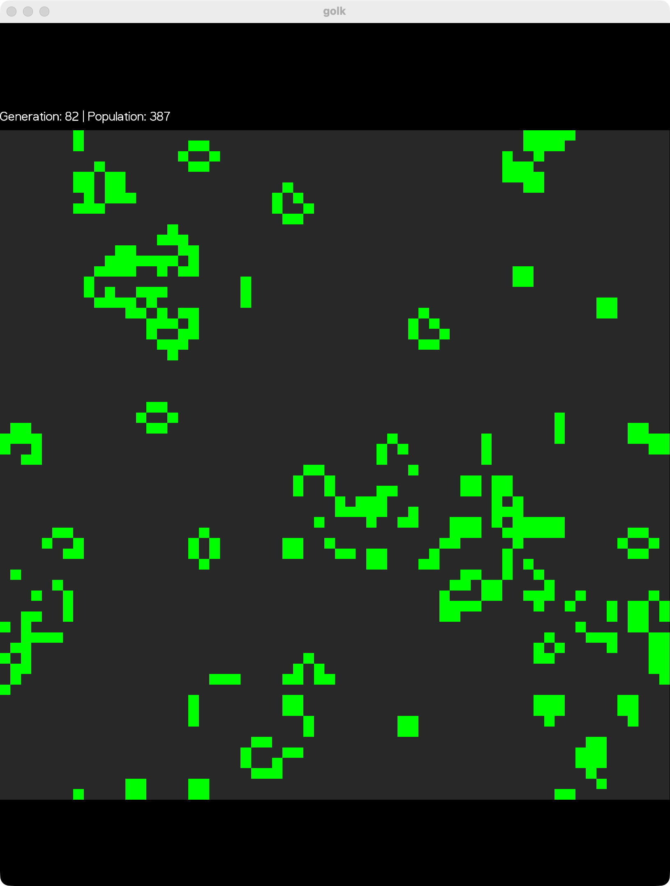

# Conway's Game of Life

[](https://github.com/leeturner/conways-game-of-life-kotlin/actions/workflows/build.yml)
[](LICENSE)

[Conway's Game of Life](https://en.wikipedia.org/wiki/Conway%27s_Game_of_Life) in the terminal, written in Kotlin
with Micronaut and functional programming with [Arrow](https://arrow-kt.io/). Watch generations of cells evolve in
colour in your terminal, or in a [KorGE](https://korge.org/) 2D window.




## Features

- A toroidal universe: the grid wraps around, so cells on one edge are neighbours of cells on the opposite edge
- Only live cells and their neighbours are checked each generation, not the whole grid
- Drawn in the terminal with ANSI colours, or in a KorGE window with `--renderer korge`
- Grid sizes from 3 to 256, with a random starting pattern each time
- Errors handled with Arrow's `Either`

## The rules

1. **Underpopulation:** any live cell with fewer than two live neighbours dies.
2. **Survival:** any live cell with two or three live neighbours lives on to the next generation.
3. **Overpopulation:** any live cell with more than three live neighbours dies.
4. **Reproduction:** any dead cell with exactly three live neighbours becomes a live cell.

## Requirements

- Java 25 or later

## Usage

Run it with Gradle, with the default 64 by 64 grid:

```bash
./gradlew run
```

Or with options:

```bash
./gradlew run --args="--grid-size 32"
./gradlew run --args="--renderer korge"
```

| Option | Meaning |
|---|---|
| `-g, --grid-size <size>` | The grid size, from 3 to 256 (default: 64) |
| `-r, --renderer <terminal\|korge>` | Draw in the terminal or a KorGE window (default: terminal) |
| `-h, --help` | Show help and exit |

To run it without Gradle, install it and use the `golk` command:

```bash
./gradlew installDist
./build/install/golk/bin/golk --grid-size 100
```

## Configuration

The application can be configured via `src/main/resources/application.properties`:

- `universe.renderer.alive-cell-color`: ANSI colour code for alive cells (default: green)
- `universe.renderer.dead-cell-color`: ANSI colour code for dead cells (default: grey)

Available ANSI colour codes:
- `\u001b[31m` - Red
- `\u001b[32m` - Green
- `\u001b[33m` - Yellow
- `\u001b[34m` - Blue
- `\u001b[35m` - Magenta
- `\u001b[36m` - Cyan
- `\u001b[90m` - Grey
- `\u001b[91m` - Bright Red
- `\u001b[92m` - Bright Green
- `\u001b[94m` - Bright Blue

## How it works

### The universe

The universe is represented as a `Set<Coordinate>` containing only alive cells. This sparse representation:
- Reduces memory usage for typical Game of Life patterns
- Speeds up the tick algorithm by avoiding checks of empty space
- Allows for efficient lookup of cell states

### Each tick

Instead of checking all `gridSize × gridSize` cells each generation, the algorithm:
1. Collects all alive cells
2. Gathers all neighbors of alive cells
3. Only evaluates rules for this combined set
4. Typically processes far fewer cells than the full grid

This is particularly effective for sparse populations, which are common in Conway's Game of Life.

### Errors

The project uses functional error handling with Arrow's `Either` type:
- `UniverseMinimumSizeError`: Grid size must be at least 3×3
- `UniverseCoordinatesOutOfBoundsError`: Initial cells must be within grid bounds
- `UniverseNoAliveCells`: Universe must have at least one alive cell

## Building

`./gradlew build` compiles the code and runs the tests, Detekt and Kotlinter. The tests cover the four rules, wrapping
at the edges of the universe, still lifes (block, beehive, tub) and oscillators (blinker, toad, beacon). To fix
formatting, run `./gradlew formatKotlin`.

## Licence

Apache 2.0. See [LICENSE](LICENSE).
